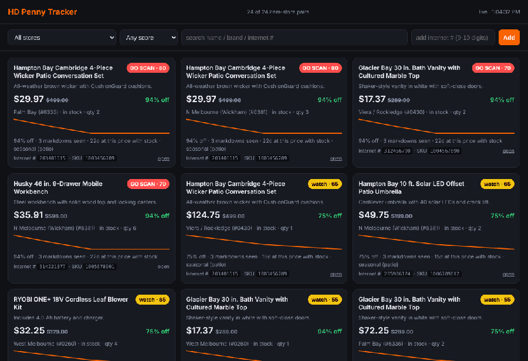
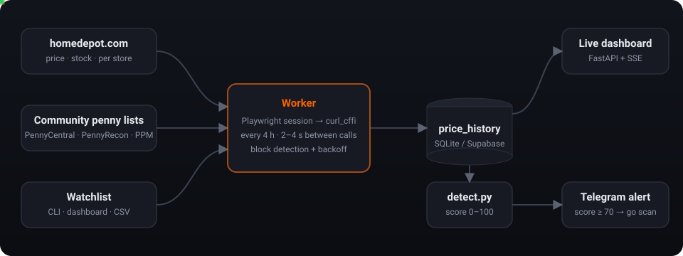
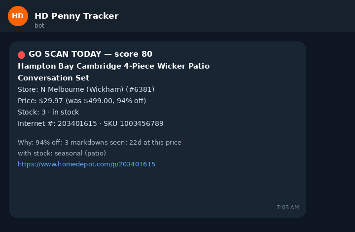

<h1 align="center">HD Penny Tracker</h1>

<p align="center">
  Tracks Home Depot clearance <b>store by store</b>, keeps the full price history, scores how close an item is to the $0.01 "penny" stage, and pings me on Telegram when it's worth driving out to scan.
</p>

<p align="center">
  
</p>

> Penny items never show as $0.01 online — that price lives in the store register. This tool finds the items that are <i>about</i> to get there, so I know where to go scan with the Home Depot app. The scan at self-checkout is the only confirmation.

## How it works

<p align="center"></p>

1. **Watch** – I add products by internet number (CLI, dashboard or CSV). Public penny lists (PennyCentral, PennyRecon, Penny Pinchin' Mom, Paydirt) are pulled once a day and added automatically.
2. **Scrape** – every 4 hours the worker opens one real browser session to pass the bot check, then reuses the cookies with `curl_cffi` to read price, original price, stock and availability for each product in each of my stores. 2–4 s between calls, block detection, backoff.
3. **Remember** – every observation is appended to `price_history`. Nothing is overwritten, so markdown count and time-on-shelf are real numbers.
4. **Score** – `detect.py` turns the history into a 0–100 score.
5. **Act** – score ≥ 70 → Telegram "go scan today". The dashboard updates live over Server-Sent Events.

## What the tracker is looking for

<p align="center"></p>

<p align="center"></p>

The "ZMA flip" is the one remote signal that an item was probably pennied: it jumps back to full price online and goes *unavailable* in that store right after sitting at deep clearance with stock.

## What I get

<p align="center">
  
  
</p>

Dashboard: one card per item per store with price, % off, stock, sparkline of the history, score badge and the reasons. Filter by store / score / text, add items from the aisle on my phone.

## Run it

```bash
git clone https://github.com/alejandrojosegomez/HD-Penny-Tracker.git && cd HD-Penny-Tracker
cp .env.example .env                 # Telegram token + chat id (Supabase optional)
pip install -r requirements-dev.txt && playwright install chromium

python -m tracker add 203401615 --category patio   # internet number = number at the end of the product URL
python -m tracker scrape                            # watchlist × stores, once
python -m tracker detect                            # score + alerts
python -m tracker serve                             # dashboard → http://localhost:8000
python -m tracker run                               # scheduler (worker)
```

Or `docker compose up -d --build` for worker + dashboard together (one image, runs as a non-root user; `.env` and `data/` are mounted, never baked into the image). The dashboard is published on `127.0.0.1:8000` only; see the comment in `docker-compose.yml` to open it to your Wi-Fi.

### Manual prices (current mode)

Home Depot's bot protection currently refuses the scraper, so `SCRAPE_ENABLED=false` turns automatic scraping off and prices are entered by hand: the **✍️ Anotar un precio** form in the dashboard's *Vigilados* view, or

```bash
python -m tracker price 335104182 0260 0.01 --was 59.97 --qty 3   # internet #, store, price now
```

Each entry is scored right away and sends the Telegram alert at 70+. The original price is what the discount is computed from (it's reused from the last entry when left out), and `--qty` tells the score whether the shelf has stock. The worker keeps refreshing the community lists every morning and re-scores on the old scrape schedule.

### Price providers

When scraping is on, prices come from the provider named in `PRICE_PROVIDER` (`tracker/providers/`). Every provider returns the same normalized observation (internet #, store, price, original price, stock, availability, source, time), and manual entry saves through the same path.

| `PRICE_PROVIDER` | What it is |
|---|---|
| `hd_direct` (default) | The original client in `tracker/hd_client.py`. Home Depot's Akamai Bot Manager blocks it; kept only so existing setups behave the same. |
| `licensed_api` | Integration point for a licensed price/inventory data API. Not wired to a vendor yet: fill in `_request` / `_normalize` once a vendor's terms are confirmed to allow this use. Key goes in `PRICE_API_KEY`. |
| `sample` | Reads `tests/fixtures/sample_observations.json` (or `SAMPLE_OBSERVATIONS`). No network; for development and tests. |
| `mock` | Scriptable fake responses (`tracker/providers/fixtures/mock_responses.json`), including SKU lookups and simulated errors. No network; marked `mocked` in the data. |

A refusal (`access_denied` or `rate_limited`) ends the run immediately with a Telegram notice: no retries, no extra requests until the next schedule. The project does not try to get around Home Depot's bot protection (no CAPTCHA solving, stealth browsing, fingerprint spoofing or proxy rotation). Details in `tracker/providers/README.md`.

### Collector and API (HD Penny Intelligence Platform)

A collection engine (`python -m tracker collect`, scheduled jobs, single products, SKUs or stores, request budget, cache, validation, job history) and an authenticated JSON API under `/v1` (`X-API-Key`) for other apps: products, stores, price history, observation submission, collection jobs, monitoring. The dashboard has a new **📈 Monitoreo** view. Everything runs through the same provider interface and the same single write path as manual entry. **No live data source is connected yet:** `mock` and `sample` are fake data. Setup, Windows PowerShell commands, endpoint reference and what's needed for a live source: [docs/PLATFORM.md](docs/PLATFORM.md).

**Stores** live in `config/stores.yaml` (mine: `0260` West Melbourne, `6381` N Melbourne, `6336` Palm Bay, `0430` Viera). **Storage** is SQLite by default; set `DATABASE_MODE=supabase` to write through to Postgres (`supabase/schema.sql`).

## Stack

Python 3.12 · Playwright · curl_cffi · SQLite / Supabase · FastAPI + SSE · APScheduler · Telegram Bot API · Docker

```
tracker/
  session.py    browser bootstrap → cookies      detect.py     scoring → alerts
  hd_client.py  GraphQL + HTML fallback          notify.py     Telegram
  scraper.py    watchlist × stores               scheduler.py  jobs
  community.py  public penny lists               web.py        dashboard API + SSE
  storage.py    SQLite / Supabase                cli.py        python -m tracker …
  collector/    collection engine, budget, cache, validation, jobs, monitoring
  providers/    adapter interface + mock / sample / licensed_api / hd_direct
  api_v1.py     authenticated /v1 API
```

## Notes

- `homedepot.com` is behind Akamai, so this runs from a home IP (my PC or a Raspberry Pi), not a cloud box. Personal use, low volume, nothing behind a login, nothing resold.
- The GraphQL query in `tracker/graphql/product.graphql` is a minimal field set; if Home Depot changes it, the HTML fallback kicks in and the comment in that file explains how to re-capture the request from DevTools.
- Buying a penny is legal; the store can still say no. Don't swap tags, don't hide stock, don't argue.

## Roadmap

- [ ] Category sweep (`searchModel`) to discover clearance I'm not watching yet
- [ ] Supabase Realtime + Next.js front end on Vercel
- [ ] Lowe's module

## License

MIT – see [LICENSE](LICENSE.md).

---

<p align="center">
  <picture>
    <source media="(prefers-color-scheme: dark)" srcset="assets/signature-light.png">
    
  </picture>
</p>
