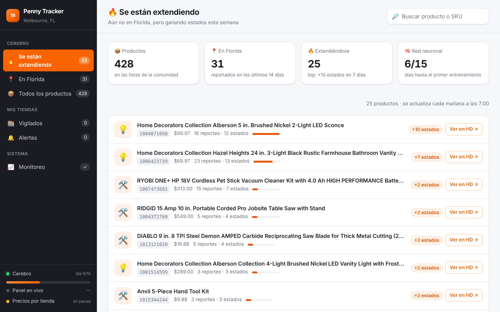
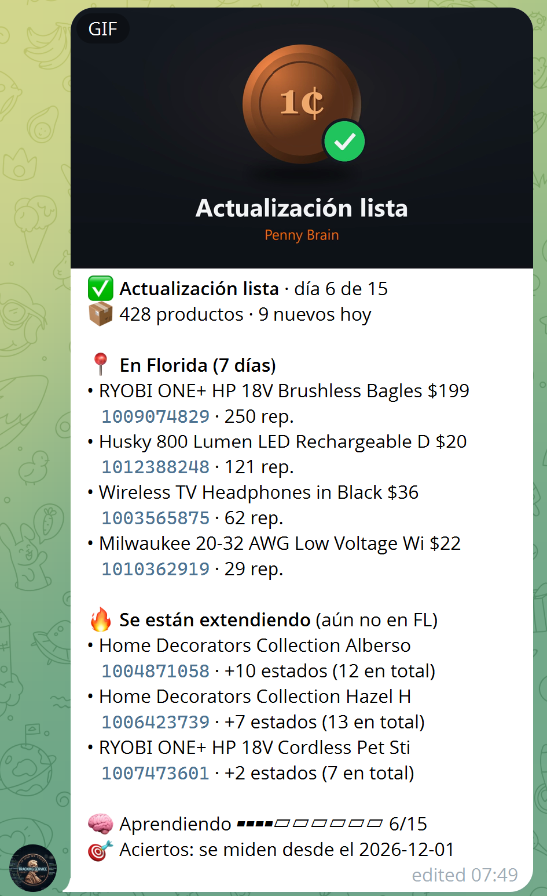
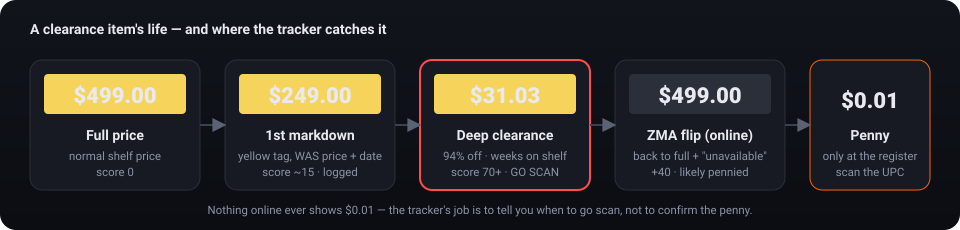

<h1 align="center">HD Penny Tracker</h1>

<p align="center">
  Follows Home Depot penny items as the community reports them, learns which ones are spreading toward Florida, and tells me on Telegram every morning. For my four Melbourne-area stores it keeps a price history and scores how close an item is to the $0.01 "penny" stage.
</p>

<p align="center">
  
</p>

> Penny items never show as $0.01 online. That price lives in the store register, so the scan at self-checkout is the only confirmation. This project points me at what's worth scanning.

## What runs today

| Part | Status | What it does |
|---|---|---|
| **Penny Brain** (`brain/`) | ✅ Runs every day | Reads the public penny lists, tracks which items are spreading state to state, and sends the morning summary to Telegram. |
| **Store tracker** (`tracker/`) | ✅ Manual prices | I type prices I see in my stores; each one is saved, scored 0–100, and alerts me at 70+. |
| **Automatic store prices** | ⛔ Blocked | Home Depot's bot protection refuses automated price reads, so scraping is turned off. |
| **Collector + API** (`tracker/collector/`, `/v1`) | 🧪 Built, no live source | Ready for a permitted data provider; today it only runs on mock data. |

## Penny Brain: the daily Telegram summary

Every morning at 7:00 AM (Florida) a GitHub Actions workflow (`.github/workflows/brain-daily.yml`) runs `python -m brain.run`:

1. **Collect**: pulls the public Home Depot penny lists from PennyRecon, Paydirt and Penny Pinchin' Mom.
2. **Track**: records every item, which states reported it and when, and finds the items that are gaining states but haven't reached Florida yet.
3. **Learn**: saves a daily snapshot. After 15 days of history a small neural network starts predicting which items will reach Florida within 14 days, and it retrains every day. Its hit rate is measured from 2026-12-01.
4. **Report**: commits the results back to the repo ([brain/README.md](brain/README.md), [daily reports](brain/reports/README.md), [products.csv](brain/products.csv)) and sends the summary to Telegram.

<p align="center">
  
</p>

The message shows the day count, how many products are known, the items reported **in Florida** in the last 7 days, the items **spreading** (gaining states, not in Florida yet), and the learning progress. While it runs, the message shows a spinning-penny animation that turns into the check mark when done. If a run fails, an alert goes to Slack.

I can also tell the bot what I found in a store, which the brain stores as outcomes: `/penny <SKU> <store>` or `/no <SKU>`.

The dashboard reads the brain's data straight from GitHub: **🔥 Se están extendiendo**, **📍 En Florida** and **📦 Todos los productos**.

## Store tracker: my four stores

Stores live in `config/stores.yaml`: `0260` West Melbourne, `6381` N Melbourne, `6336` Palm Bay, `0430` Viera.

**Manual prices (current mode).** Home Depot blocks automated reads, so `SCRAPE_ENABLED=false` and I enter what I see on the shelf or in the Home Depot app. Use the **✍️ Anotar un precio** form in the dashboard's *Vigilados* view, or:

```bash
python -m tracker price 335104182 0260 0.01 --was 59.97 --qty 3   # internet #, store, price now
```

Every observation is appended to `price_history`; nothing is overwritten, so the markdown count and time on the shelf are real numbers. Each entry is scored right away by `tracker/detect.py`:

<p align="center"></p>

<p align="center"></p>

At **45+** an item shows up under *Alertas* as "watch"; at **70+** the bot also sends a "🔥 GO SCAN TODAY" message with the store, price, discount, stock and the reasons. The original price is what the discount is computed from (reused from the last entry when left out), and `--qty` tells the score whether the shelf has stock. A single sighting at 99% off scores 50: the score climbs with repeated markdowns, time at the price with stock, and community reports.

The "ZMA flip" is the one remote signal that an item was probably pennied: it jumps back to full price and goes *unavailable* in that store right after sitting at deep clearance with stock.

### Why automatic scraping is off

The tracker was first built to read prices itself (`tracker/hd_client.py`: one real browser session, then cookie reuse, 2–4 s between calls). Home Depot's Akamai Bot Manager now refuses it, and this project does **not** try to get around that: no CAPTCHA solving, stealth browsing, fingerprint spoofing or proxy rotation. A refusal ends the run with one Telegram notice. That code stays only so the provider can be swapped for a permitted source later.

## Collector and API

A collection engine and an authenticated JSON API sit on top of the tracker, so other apps can read the data and a permitted data provider can be plugged in later:

* **Collector**: `python -m tracker collect` for the whole watchlist, single products, SKUs or stores. It has a request budget, an optional cache, validates every observation, records each job, and stops on any refusal.
* **API** (`/v1`, FastAPI, `X-API-Key` header): products, stores, price history, observation submission, collection jobs, monitoring. Interactive docs at `http://localhost:8000/docs`.
* **📈 Monitoreo** view in the dashboard: job status, last successful run, provider errors, API usage, price changes.

**No live data source is connected.** The `mock` and `sample` providers return made-up data, marked `mocked` in the database, and `licensed_api` is an empty integration point. Configuration, endpoints and what a live source would need are in [docs/PLATFORM.md](docs/PLATFORM.md).

## Run it

**Penny Brain**: nothing to run. It's scheduled on GitHub; it needs the `TELEGRAM_TOKEN` and `TELEGRAM_CHAT_ID` repository secrets (plus `SLACK_WEBHOOK_URL` for failure alerts). To run it by hand: Actions → *Brain daily* → *Run workflow*, or locally:

```bash
pip install -r brain/requirements.txt
python -m brain.run --no-send        # prints the Telegram message instead of sending it
```

**Store tracker and dashboard** (Python 3.12):

```bash
git clone https://github.com/alejandrojosegomez/HD-Penny-Tracker.git && cd HD-Penny-Tracker
cp .env.example .env                 # Telegram token + chat id; SCRAPE_ENABLED=false
pip install -r requirements-dev.txt

python -m tracker add 1006423739 --category lighting   # internet number = number at the end of the product URL
python -m tracker price 1006423739 0260 0.06 --was 129 --qty 2
python -m tracker serve              # dashboard + API → http://localhost:8000
python -m tracker run                # worker: community lists every morning, re-scoring through the day
python -m tracker status             # last runs + counts
```

**Docker (optional).** The repo also includes a `Dockerfile` and `docker-compose.yml` that run the worker and the dashboard in containers (`docker compose up -d --build`). It's not required; see [docs/PLATFORM.md](docs/PLATFORM.md) for the details and Windows commands.

**Storage** is SQLite (`data/tracker.db`) by default; set `DATABASE_MODE=supabase` to also write to Postgres (`supabase/schema.sql`).

## Stack

Python 3.12 · FastAPI + Server-Sent Events · SQLite / Supabase · APScheduler · scikit-learn (Penny Brain) · GitHub Actions · Telegram Bot API

```
brain/          daily community collection, spreading analysis, neural network, Telegram summary
tracker/
  manual.py     manual prices                    detect.py     scoring → alerts
  storage.py    SQLite / Supabase                notify.py     Telegram
  community.py  public penny lists → watchlist   scheduler.py  worker jobs
  web.py        dashboard + /api                 api_v1.py     authenticated /v1 API
  collector/    collection engine, budget, cache, validation, jobs, monitoring
  providers/    data-source adapters: mock, sample, licensed_api (stub), hd_direct (blocked)
  cli.py        python -m tracker …
web/index.html  the dashboard
```

## Notes

- Personal use, low volume, nothing behind a login, nothing resold.
- Buying a penny is legal; the store can still say no. Don't swap tags, don't hide stock, don't argue.

## Roadmap

- [ ] Connect a permitted store-level price source (see [docs/PLATFORM.md](docs/PLATFORM.md#connecting-a-permitted-live-source))
- [ ] Penny Brain's first training (day 15) and accuracy tracking from 2026-12-01
- [ ] Lowe's module

## License

MIT – see [LICENSE](LICENSE.md).

---

<p align="center">
  <picture>
    <source media="(prefers-color-scheme: dark)" srcset="assets/signature-light.png">
    
  </picture>
</p>
