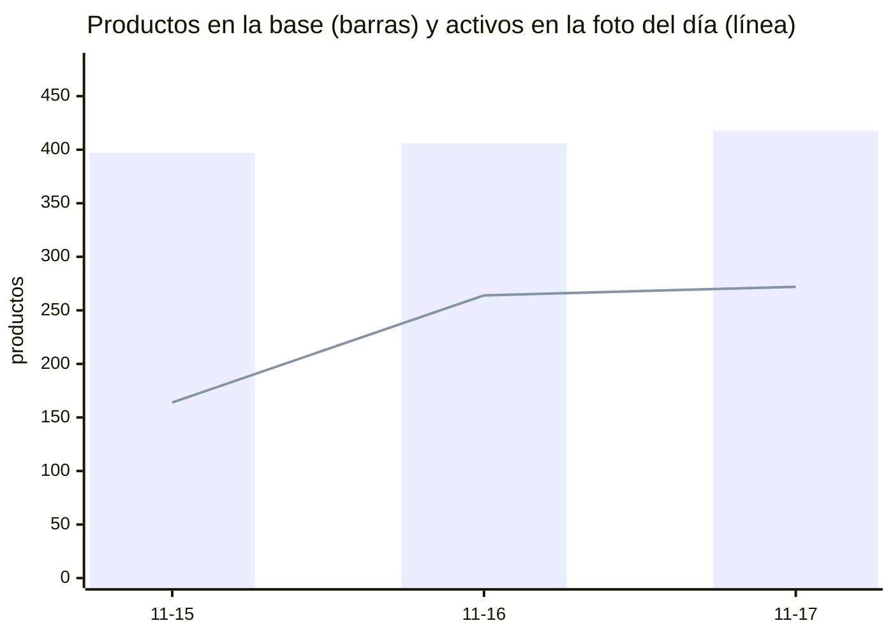
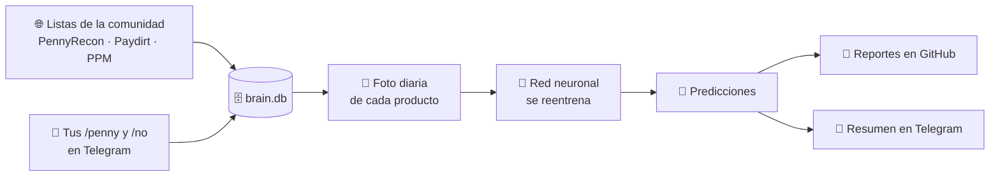

<div align="center">

# 🧠 Penny Brain

**Red neuronal que aprende sola, cada día, qué productos de Home Depot llegarán a penny en Florida.**


_Última actualización: **2026-11-17** · corre solo todos los días a las 7:00 AM (Florida)_

</div>

---

## 📈 Progreso del aprendizaje

```text
██████░░░░░░░░░░░░░░░░░░░░░░░░  3/15 días
```

🟡 Juntando datos · día **3 de 15**

La red necesita ~15 días de historia para saber, para cada producto, si 14 días después terminó reportado en Florida. Hasta entonces junta datos; después se reentrena cada día.

## 📊 Crecimiento



## 🗓️ Hoy

| Productos en la base | Nuevos hoy | En Florida (14 días) | Tus escaneos |
|:-:|:-:|:-:|:-:|
| **418** | **28** | **34** | **0** |

📄 [Reporte completo de hoy](reports/2026/11/2026-11-17.md)

### 📍 En Florida esta semana

| # | Producto | SKU | Precio | Reportes | Fuentes |
|--:|---|---|--:|--:|:-:|
| 1 | [DURASACK 20 Gal. Heavy-Duty Moving and Storage Bag Gray Poly…](https://www.homedepot.com/s/1015277793) | `1015277793` | $20 | 14 | 2 |
| 2 | [RYOBI ONE+ HP 18V Brushless Bagless Cordless Pet Mesh Filter…](https://www.homedepot.com/s/1009074829) | `1009074829` | $199 | 238 | 2 |
| 3 | [Husky 800 Lumen LED Rechargeable Detachable Tripod Work Ligh…](https://www.homedepot.com/s/1012388248) | `1012388248` | $20 | 107 | 2 |
| 4 | [Wireless TV Headphones in Black](https://www.homedepot.com/s/1003565875) | `1003565875` | $36 | 45 | 2 |
| 5 | [Milwaukee 20-32 AWG Low Voltage Wire Stripper/Cutter with Di…](https://www.homedepot.com/s/1010362919) | `1010362919` | $22 | 23 | 2 |

## 🗂️ Historial

| Día | Productos | Nuevos | Activos | En FL | Escaneos | Fuentes |
|---|--:|--:|--:|--:|--:|:-:|
| [2026-11-17](reports/2026/11/2026-11-17.md) | 418 | 28 | 272 | 34 | 0 | ✅ ✅ ✅ |
| 2026-11-16 | 406 | 142 | 264 | 32 | 0 | ✅ ✅ ✅ |
| 2026-11-15 | 397 | 0 | 164 | 31 | 0 | ✅ ✅ ✅ |

📚 [Ver todos los reportes](reports/README.md)

---

## ⚙️ Cómo funciona



Reporta tus escaneos al bot: `/penny SKU tienda` o `/no SKU tienda` (ej. `/penny 1015277793 0260`). Cada escaneo le enseña a la red.

| Carpeta / archivo | Qué es |
|---|---|
| [`brain.py`](brain.py) | la red neuronal: fotos, etiquetas, entrenamiento, predicción |
| [`community.py`](community.py) | lectores de las listas de la comunidad |
| [`run.py`](run.py) · [`dashboard.py`](dashboard.py) | el proceso diario y estas páginas |
| [`reports/`](reports/README.md) | un reporte por día, por año/mes |
| [`predictions.csv`](predictions.csv) | ranking de hoy, para otras partes del proyecto |
| `state/` | base de datos y modelo (los actualiza el bot) |

Correr a mano: pestaña **Actions → Brain daily → Run workflow**.
